# inkyframe

**A calm e-ink picture frame that shows what matters today – and anyone can add new screens.**

Raspberry Pi Zero 2 W + Pimoroni Inky Impression 7.3" (Spectra 6, 800×480).
Controlled from your phone (web app). Every screen is a small
[plugin](docs/PLUGINS.md) – write your own in one Python file, no Pi needed to develop it.

<p align="center">
  <a href="docs/media/inkyframe-demo.mp4">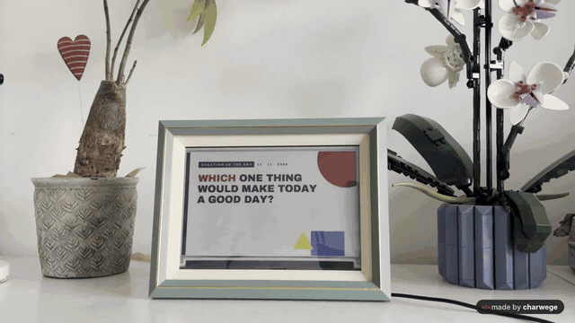</a><br>
  <sub>▶ <a href="docs/media/inkyframe-demo.mp4">Watch the full 60-second video (with sound)</a></sub>
</p>

| Weather & Calendar | Word Clock | Chess Puzzle |
|---|---|---|
| 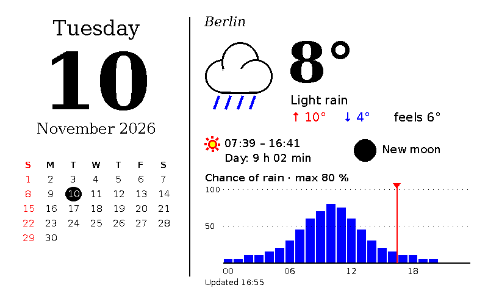 | 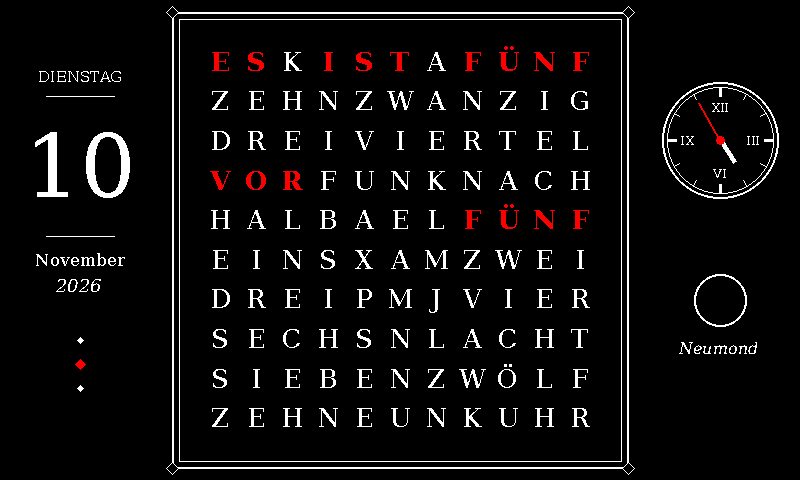 |  |
| **Thought of the Day** | **Spotify** | **Grid Signal** |
| 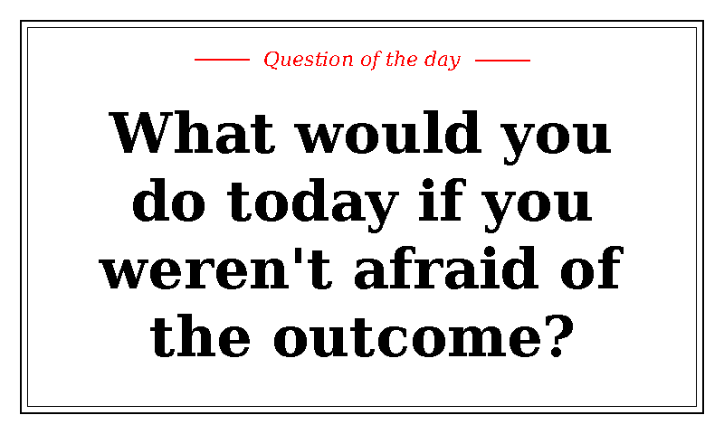 | 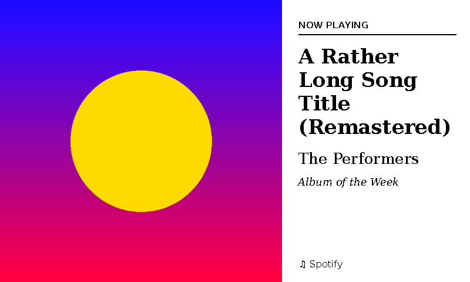 | 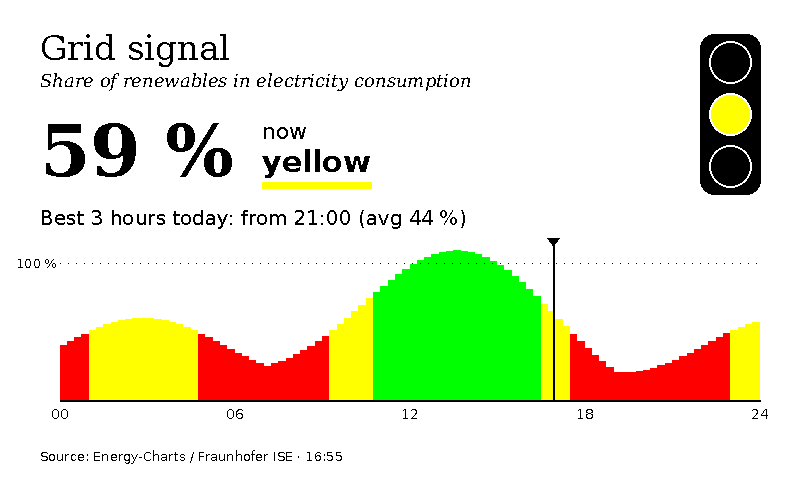 |
| **Art of the Day** | **Waste Collection** | **Weather Warnings** |
| 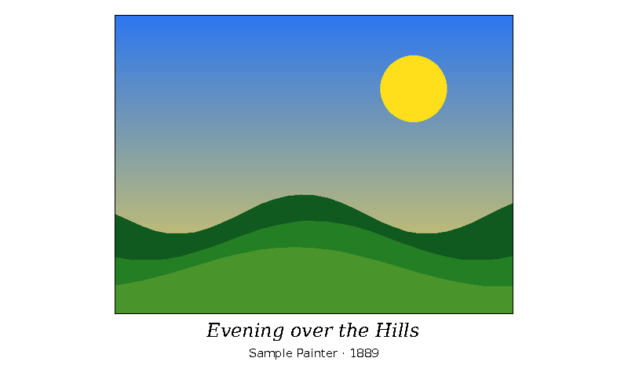 | 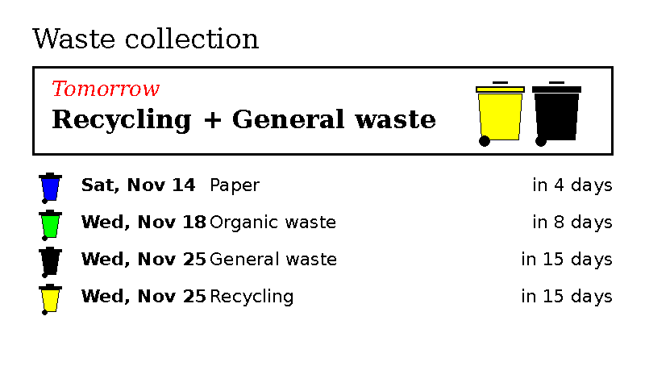 | 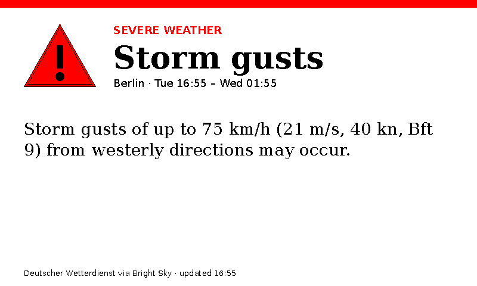 |
| **Guest Wi-Fi** | **Habit Tracker** | **Sudoku of the Day** |
| 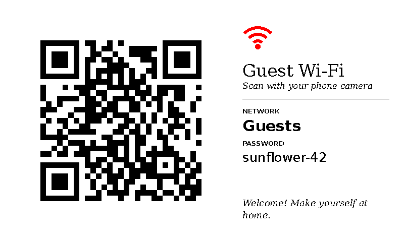 | 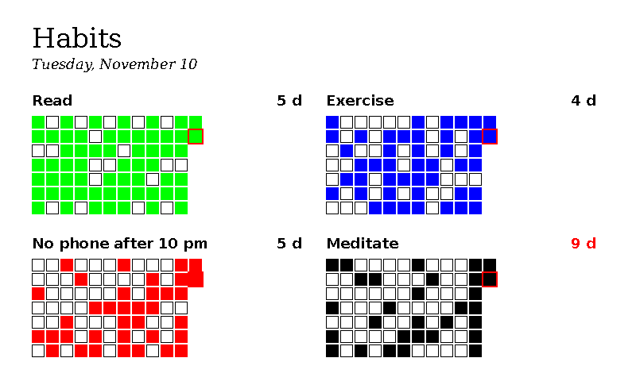 |  |
| **Solar Power** | **Water Level** | **Birthdays** |
| 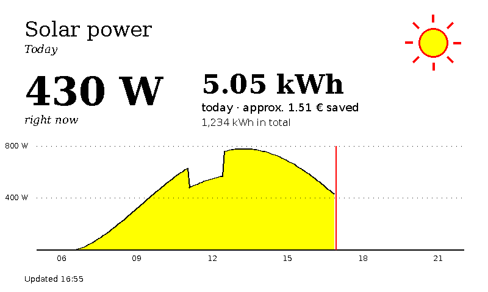 | 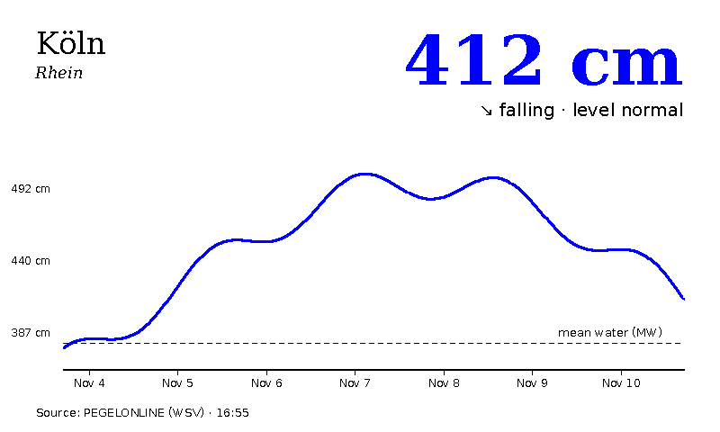 | 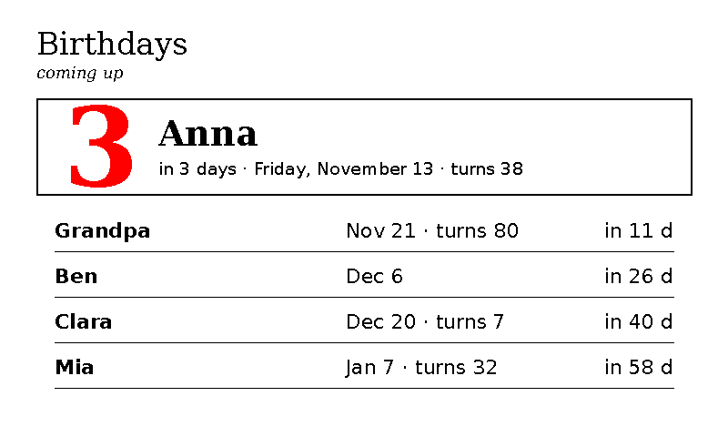 |
| **Watchlist** | **Countdown** | |
| 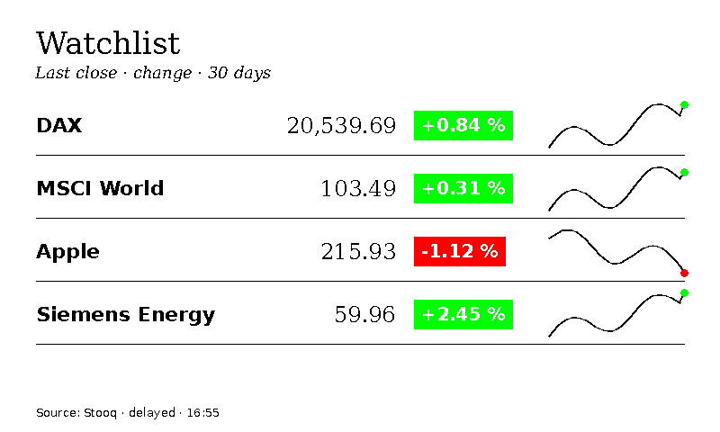 | 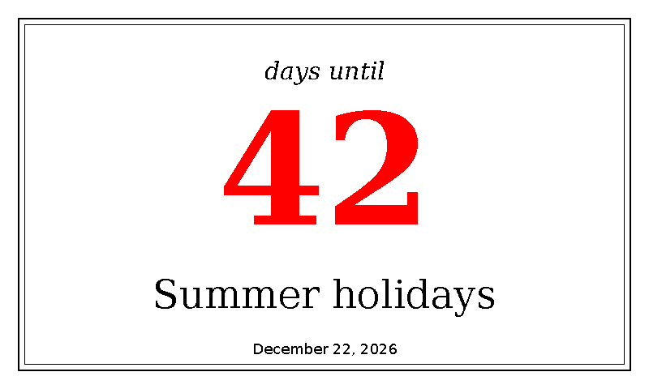 | |

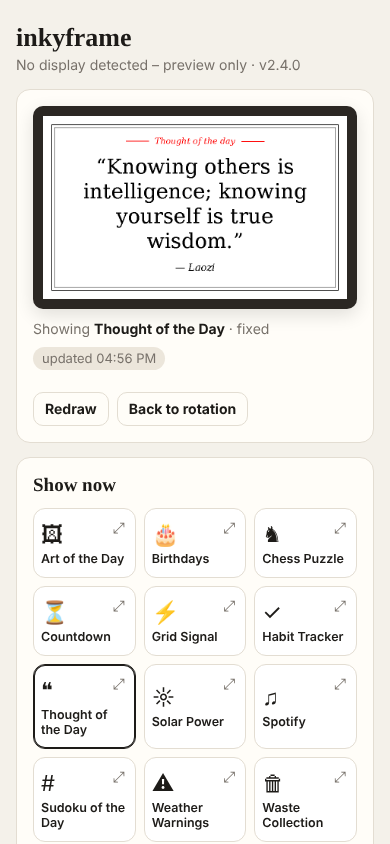

## Features
- **17 built-in plugins** – see the gallery above
- **Rotation** with per-plugin durations, **fixed mode**, **quiet hours**
- **Interrupts** – plugins can take over the screen when it matters: Spotify while music plays,
  waste collection the evening before, weather warnings, birthdays on the day
- **A design per screen** – in the rotation list every plugin can get its own design (weather as a newspaper, the question in Zen …)
- **Demo mode** – walks through all plugins, designs and languages with built-in sample data, made for filming a showcase video
- **13 designs** – from *Classic* to *Bauhaus*, *Pixel*, *Blueprint* or *Chalkboard* – for the frame and the web app
- **12 display languages** English, Deutsch, Français, Español, Italiano, Português, Nederlands, Svenska, Dansk, Norsk, Suomi, Polski – selectable in the web app (dates, numbers, holidays, quotes and plugin texts are localised)
- Redraws only when the picture really changes – easy on the e-ink panel
- **Plugin API** with auto-generated settings forms, background polling, QR codes, offline previews and CI

## Designs
Thirteen designs, picked in the web app (*Design* card). A design changes fonts, headings, frames and
accent colours of every plugin; dark designs recolour the whole screen. The web app can follow the frame
or use its own design. The ten studio designs also bring their own signature layout for *Weather & Calendar*
and *Thought of the Day* (Bauhaus shapes, a newspaper front page, a pixel-game dialogue, a blueprint with
title block …).

| Basics | Studio designs |
|---|---|
| Classic · Modern · Playful | Bauhaus · Newspaper · Art déco (dark) · Pixel (dark) · Zen · Swiss · Memphis · Blueprint (dark) · Botanical · Chalkboard (dark) |

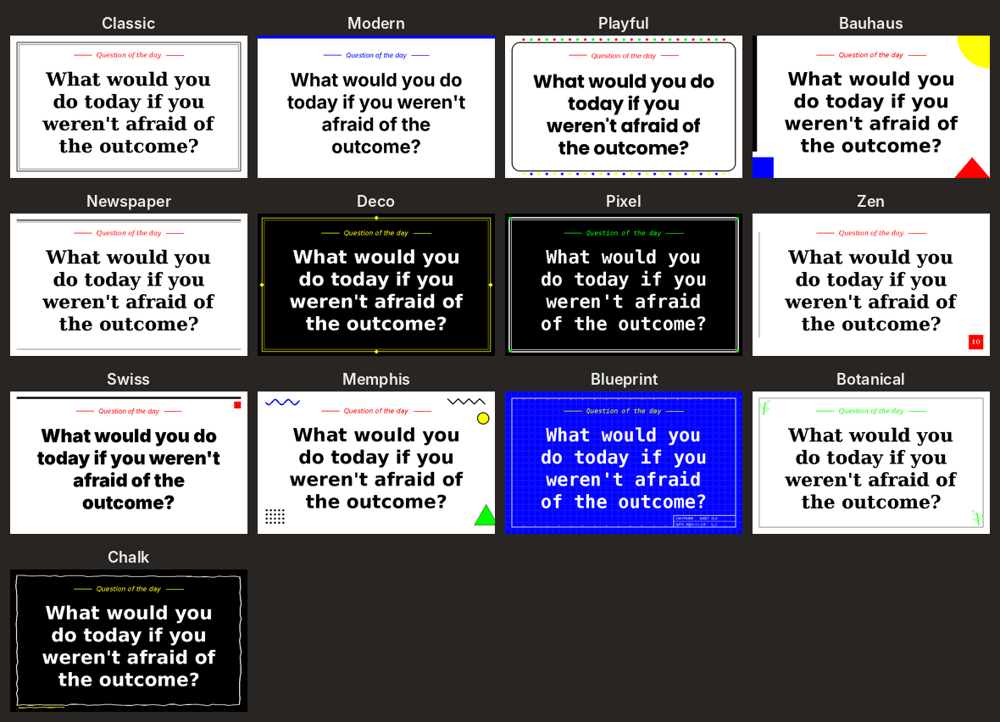

<details><summary>Signature layouts of the studio designs</summary>

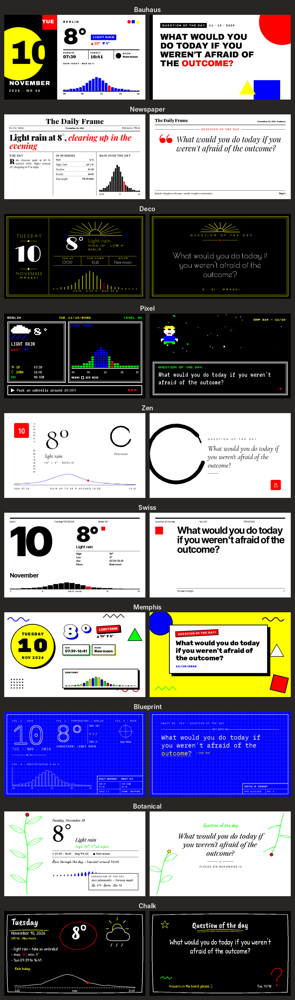
</details>

Fonts: *Classic* uses DejaVu, *Modern* Inter, *Playful* Comic Neue (apt). The studio designs use Google Fonts
(SIL Open Font License) that `install.sh` downloads – or the web app fetches them the first time you pick a design
(`python -m inkyframe.fonts` does it by hand). Until then a design falls back to DejaVu.
Your own `.ttf` files in `data/fonts/<design>/` (`serif.ttf`, `serif-bold.ttf`, `sans.ttf`, `display.ttf` …) override any design.

## Hardware
- Raspberry Pi Zero 2 W (with header)
- Pimoroni Inky Impression 7.3" Spectra 6 (PIM773)
- a picture frame, e.g. 13×18 cm

## Install on the Pi
Enable SPI and I²C first (`sudo raspi-config` → Interface Options).

```bash
git clone https://github.com/charwege/inkyframe.git ~/inkyframe
cd ~/inkyframe && bash install.sh
```
Then open `http://<pi-name>.local:8080` on your phone (same Wi-Fi). Tip: *Add to Home Screen*.

**Update:** `cd ~/inkyframe && git pull && sudo systemctl restart inkyframe`
**Log:** `journalctl -u inkyframe -f`

Stop any other program that drives the display before installing.

## Spotify
1. Create an app at developer.spotify.com/dashboard, tick *Web API*.
2. Redirect URI exactly `http://127.0.0.1:8888/callback` (Spotify only allows http on loopback).
3. In the web app: *Plugins → Spotify*, enter client ID + secret, *Connect with Spotify*.
4. After logging in your phone shows an error page – that's expected. Copy its full address into
   *Finish connection*.

Spotify requires a Premium account for the owner of a development-mode app.

## Write a plugin
```bash
python -m inkyframe.dev new myplugin              # scaffold data/plugins/myplugin.py
python -m inkyframe.dev render myplugin --sample  # -> preview/myplugin.png
python -m inkyframe.dev check                     # what CI runs
```
Full guide: **[docs/PLUGINS.md](docs/PLUGINS.md)** · ideas: [ROADMAP.md](ROADMAP.md) ·
how to contribute: [CONTRIBUTING.md](CONTRIBUTING.md)

## Project layout
```
inkyframe/
  plugin.py       plugin API (Plugin, Setting, Context) and discovery
  engine.py       what to show when (rotation, interrupts, quiet hours)
  app.py          web app + JSON API (Flask)
  display.py      Inky driver (falls back to preview PNG)
  dev.py          developer CLI
  plugins/        built-in plugins – one file each
  templates/      phone UI
data/             local config, custom fonts, your own plugins (not in git)
tests/            pytest – every plugin must render from sample data
```

## Credits
Weather: [Open-Meteo](https://open-meteo.com) · Puzzles: [Lichess](https://lichess.org) ·
Grid data: [Energy-Charts](https://energy-charts.info), Fraunhofer ISE (CC BY 4.0) · Fonts: DejaVu

MIT licence.
